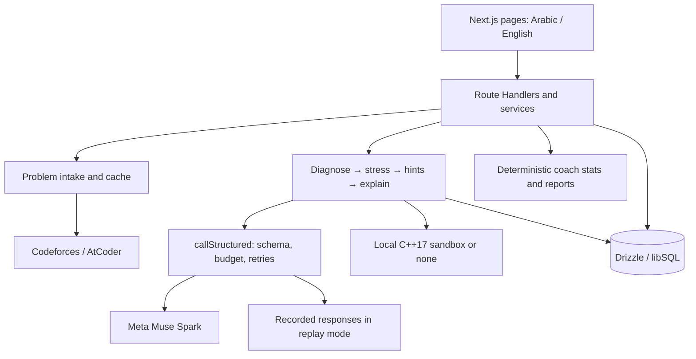

# Daleel

Daleel diagnoses competitive programming bugs with Meta Muse Spark, verifies counterexamples in a sandbox, and teaches the fix through hints in Egyptian Arabic or English.

**Daleel is a placeholder name.** Judges can run the app locally from this repository using recorded responses, without a Meta API key. No hosted deployment is required.

## What was built this week

The starting material was a Next.js scaffold, the product and prompt design docs, and example problems with buggy code. The feature build added problem intake and caching, streamed diagnosis, sandbox verification, four hint levels, re-checks, explanations and walkthroughs, Arabic/English UI, attempt history, coach dashboards and reports, and recorded demo replay. Codeforces/AtCoder supply the problems; Next.js, React, CodeMirror, Zod, Drizzle/libSQL and the SDK are existing dependencies.

The implementation and verification history is in [the build plan](docs/05-BUILD-PLAN.md); [decisions](docs/DECISIONS.md) override older design proposals.

## Run the judge demo without a key

Requires Node.js 20+ and pnpm 10. From the repository root:

```sh
pnpm i
cp .env.example .env.local
pnpm db:migrate
pnpm db:seed --demo-team
DEMO_REPLAY=1 pnpm dev
```

Alternatively, set `DEMO_REPLAY=1` in `.env.local` and run `pnpm dev`. Leave `MODEL_API_KEY` empty and `RUNNER_PROVIDER=none`. The default database is `file:./data/daleel.db`.

1. Open <http://localhost:3000>. Under **Try the demo**, choose Watermelon in English, Theatre Square in Egyptian Arabic, or the AtCoder N-choice question in English. The exact example code is filled in and diagnosis starts automatically.
2. Read the diagnosis and reveal the hints in order. A **Replay** badge shows the original recording date. Keep the example code, locale and model/effort settings unchanged: replay matches the request hash exactly.
3. Open `/coach` and select **Open demo team as coach_demo**. The seed provides 20 synthetic trainees and 120 attempts across two Cairo weeks. Inspect weak topics, trainees needing attention and the printable weekly report. If the entry is disabled, run `pnpm db:seed --demo-team` and reload.

**Recording coverage in this checkout:** diagnosis and hint ladders are committed, including the fixed Watermelon re-check. Stress and explanation recordings still need the owner's re-recording. The recorder now includes explanation plus walkthrough for all three examples and stress when the local runner is enabled. Once matching explain recordings exist, reveal Hint 3 or choose **I'm stuck**, then open the explanation. Missing recordings produce an error; replay never falls back to a live Meta call.

Recorded responses include date, model, effort, request hash, usage, cost and recording-tool provenance in [`recordings/`](recordings). Coach seed rows are explicitly synthetic. See [replay details](docs/REPLAY.md).

## Use your own Meta key

Set `MODEL_API_KEY` in the ignored `.env.local`, set `DEMO_REPLAY=0`, and run `pnpm dev`. Obtain the key from the Meta Model API dashboard; the app uses `MODEL_API_BASE_URL=https://api.meta.ai/v1`. The separate `META_API_KEY` variable belongs to Muse Code, not the app.

For production, set a persistent **`SESSION_SECRET` of at least 32 characters** before `pnpm build` and `pnpm start`. Development generates a temporary secret if it is empty; restarting invalidates those sessions.

### Optional local verification

On Linux, install the compiler and sandbox:

```sh
sudo apt install g++ bubblewrap
```

Set `RUNNER_PROVIDER=local` in `.env.local`; `pnpm smoke:runner` checks the sandbox without calling Meta. It needs unprivileged user namespaces, `timeout` and `prlimit`. Each run has no network, 2 seconds CPU, 256 MB memory and 64 KB output; stress plans have at most 12 tests. The reference program must pass official samples before a counterexample can be marked verified. With `none`, diagnosis and hints still work and display **Not verified**.

The current runner supports C++17. Replay with the local runner also needs recordings made with that runner enabled. To refresh the judge recordings with your own key:

```sh
DEMO_REPLAY=0 RUNNER_PROVIDER=none pnpm record:demo
DEMO_REPLAY=0 RUNNER_PROVIDER=local pnpm record:demo
```

The second command requires the sandbox. These commands make live, billable Meta calls. `RECORD_MAX_USD` caps each recording run; review the generated files before sharing them. Keep both sets so judges can use the default runner-free path.

## How Meta Muse Spark is used

All model calls go through `callStructured()` in [`src/llm/meta-client.ts`](src/llm/meta-client.ts), using the `openai` SDK against Meta's endpoint. Zod generates the strict JSON Schema and validates responses; the wrapper handles retries, budgets, usage logging and replay. Untrusted problem/code text is tagged in prompts.

| Step                  | Default model    | Effort | Why                                                                                         |
| --------------------- | ---------------- | ------ | ------------------------------------------------------------------------------------------- |
| Diagnose              | `muse-spark-1.3` | high   | Relate the approach, constraints and student code; identify the bug and suspicious lines.   |
| Stress, when enabled  | `muse-spark-1.3` | medium | Propose a small reference program and tests for the sandbox to check.                       |
| Hint ladder           | `muse-spark-1.3` | low    | Turn the diagnosis into four increasingly specific teaching steps.                          |
| Explain + walkthrough | `muse-spark-1.3` | medium | Explain the failure, suggest edits to the student's own lines and produce animation frames. |

Models and efforts come from `MODEL_*` and `EFFORT_*`. Hints 1–3 pass a spoiler validator; the reference program is never sent to the browser. Coach stats and the current weekly report are deterministic and make no model calls; recommendations come from the checked-in Codeforces candidate fixture.

## Evaluation and cost

These are existing results from [`eval/results/`](eval/results), not new runs for this polish change. Both used `muse-spark-1.3` with high diagnosis effort on ten cases.

| Recorded run                                                  | Bug class | Line overlap | Verified counterexamples | Total cost |
| ------------------------------------------------------------- | --------- | ------------ | ------------------------ | ---------- |
| [Oct 30, diagnosis](eval/results/2026-10-30-0207.md)          | 9/10      | 10/10        | Not run                  | $0.107453  |
| [Oct 31, diagnosis + stress](eval/results/2026-10-31-1638.md) | 10/10     | 10/10        | 8/10                     | $0.214606  |

Measured average cost was **$0.01075 per diagnosis** in the first run and **$0.02146 per diagnosis plus stress** in the second. Those figures exclude hints and explanations. The full-attempt planning estimate is about **$0.05**, with a product target of at most $0.08 on average; a full-pipeline average has not been measured here. Replay has zero LLM cost. Usage is stored in `llm_calls`; `DAILY_BUDGET_USD` defaults to $10.

The Oct 31 run skipped one stress case and found no mismatch on AtCoder's case-sensitive output example. That result predates the PR-24A checker fix; no post-fix live eval is claimed. `pnpm eval` makes live Meta calls; `pnpm test` uses fixtures and fakes only.

## Architecture



## Checks and known limits

```sh
pnpm lint
pnpm typecheck
pnpm test
pnpm test:e2e
```

Playwright needs Chromium installed separately with `pnpm exec playwright install chromium`. Local runner integration tests are opt-in.

- This is a demo with handle-only sessions: knowing a handle resumes that identity. It is not password authentication.
- Replay covers exact recorded requests, not arbitrary submissions. Explanation and stress coverage depend on the matching files being present.
- Verification tests a small generated plan, not an exhaustive judge suite. Model diagnoses and traces can be wrong.
- Codeforces scraping can be blocked by Cloudflare; paste the statement when fetching fails. The live-contest guard covers Codeforces, not AtCoder.
- Code, statements, samples and walkthrough data stay LTR inside the Arabic UI. Voice and screenshot intake remain unimplemented stretch items.

Product scope: [PRD](docs/02-PRD.md). External evidence: [VERIFIED.md](docs/VERIFIED.md). Contributor rules: [AGENTS.md](AGENTS.md).

## License

[MIT](LICENSE), copyright Daleel contributors.
