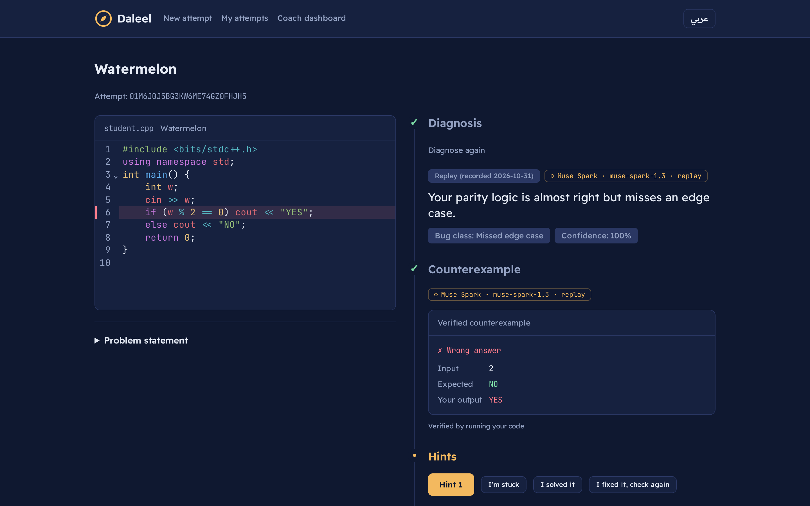
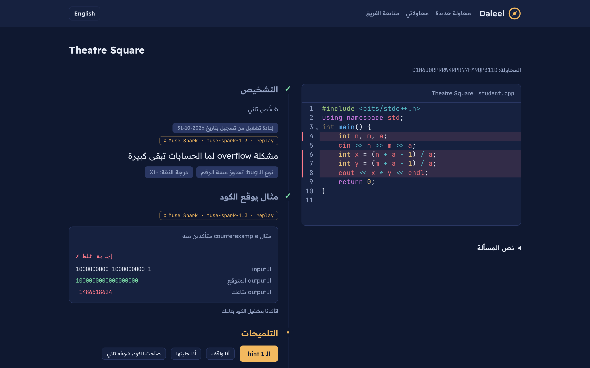
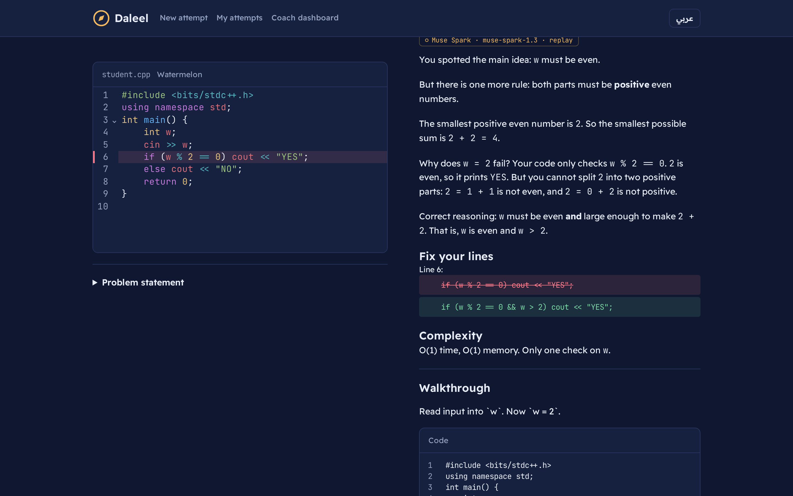
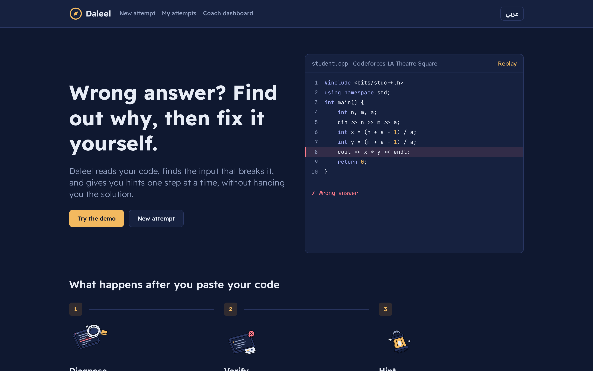
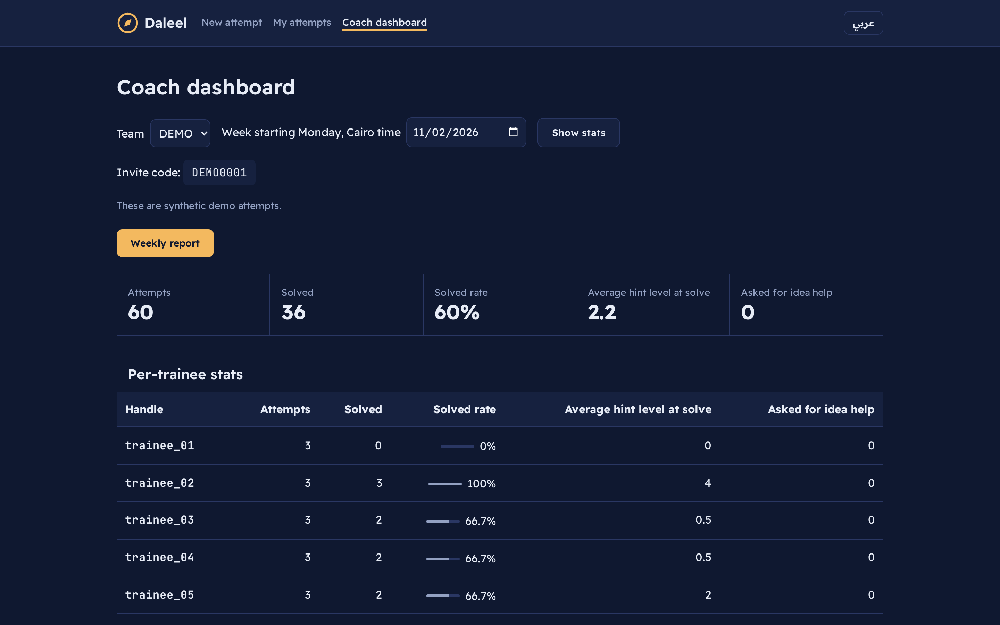
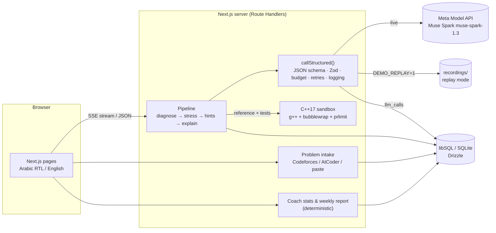

<div align="center">


# Daleel · دليل

**An Arabic-first debugging coach for competitive programmers, powered by Meta Muse Spark**

[](https://youtu.be/_NSyiz4w2vY)
[](#how-meta-muse-spark-is-used)
[](LICENSE)

</div>

Daleel (دليل, "guide") finds out _why_ your Codeforces or AtCoder solution gets Wrong Answer, proves it with a counterexample it actually ran, and coaches you to the fix with hints in Egyptian Arabic or English — powered end to end by Meta Muse Spark.



## The problem

Competitive programming is one of the main ways Arab students get into software careers, ICPC, and big-tech interviews. But when a solution fails, the judge only says `Wrong answer on test 7` — and the hidden test is never shown. Most help that exists is in English, assumes a senior mentor is available, or simply hands over the accepted code, which teaches nothing.

Arab trainees and the volunteer coaches who run university and school teams need something else: an explanation in the language they think in, a **concrete failing input**, and hints that make them find the bug themselves.

## What Daleel does

1. **Paste a problem and your code.** Codeforces/AtCoder problems are fetched by URL or ID (or pasted when the site blocks fetching). Statements render with KaTeX math.
2. **Diagnose.** Muse Spark relates the problem's constraints and the intended idea to _your_ lines, classifies the bug (overflow, edge case, wrong algorithm, TLE, …) and highlights the suspicious lines.
3. **Verify.** Muse Spark writes a small reference program and a stress plan; Daleel compiles and runs both against your code in a sandbox and shows the input where your output differs — **only marked "verified" if it really ran**.
4. **Hint ladder.** Four increasingly specific hints (a spoiler validator blocks the answer from hints 1–3). An "idea hints" mode helps before you have code.
5. **Explain + walkthrough.** After hint 3 (or "I'm stuck"): the reasoning, an edit to your own lines, complexity, and an animated step-by-step trace of your code on the failing input.
6. **Re-check** your fixed code, and **coach dashboard**: per-trainee stats, weak topics, who needs attention, and a printable weekly report.

Everything works in **Egyptian Arabic (RTL)** and **English**; code, math and identifiers stay LTR inside Arabic text. A diagnosis viewed in the other language is translated once by Muse Spark and cached.

| Arabic (RTL), verified overflow counterexample         | Explanation, fix and walkthrough                    |
| ------------------------------------------------------ | --------------------------------------------------- |
|  |  |

| Home                               | Coach dashboard (synthetic demo team)             |
| ---------------------------------- | ------------------------------------------------- |
|  |  |

## How Meta Muse Spark is used

All AI in Daleel is **Meta Muse Spark (`muse-spark-1.3`) through the Meta Model API** (`https://api.meta.ai/v1`, OpenAI-compatible, called with the `openai` SDK). There is no other model provider.

Every AI-produced result in the UI carries a provenance chip with the model and the measured latency of that call (or `replay` / `cached`):


| Step                    | Effort (default) | Output                      | What Muse Spark does                                                                                                                                                                      |
| ----------------------- | ---------------- | --------------------------- | ----------------------------------------------------------------------------------------------------------------------------------------------------------------------------------------- |
| Diagnose                | `high`           | `Diagnosis` JSON            | Reads statement, constraints, samples, verdict and code; returns bug class, confidence, suspect lines, suspect inputs, a public summary in the user's language.                           |
| Stress / counterexample | `medium`         | `StressPlan` JSON           | Writes a reference C++ program and small targeted tests. Daleel runs them in the sandbox; the reference must pass the official samples first. The reference is never sent to the browser. |
| Hint ladder             | `low`            | `HintLadder` JSON           | Four teaching steps that point at the student's own lines; hints 1–3 pass a spoiler validator.                                                                                            |
| Idea hints              | `low`            | `HintLadder` JSON           | Hints for "I don't know how to start" (no code yet).                                                                                                                                      |
| Explain + walkthrough   | `medium`         | `Explanation` JSON          | Explanation, line edits, complexity note and animation frames (variables per step).                                                                                                       |
| Translate               | `minimal`        | `DiagnosisTranslation` JSON | Translates the public diagnosis when viewed in the other UI language.                                                                                                                     |

Implementation details ([`src/llm/meta-client.ts`](src/llm/meta-client.ts), `callStructured()`):

- **Structured outputs:** each step's Zod schema is converted to a strict JSON Schema (`response_format: json_schema, strict: true`) and every response is re-validated with Zod and domain validators (line numbers exist, hints don't spoil, Arabic text style).
- **Reasoning effort per step** via `EFFORT_*` env vars, and completion budgets that include reasoning tokens (`MAXTOK_*`).
- **Caching:** `prompt_cache_key` per problem with `prompt_cache_retention=24h`; identical submissions reuse a diagnosis for 24 h; ladders, translations and explanations are cached per attempt and locale.
- **Cost guard:** every call is logged to `llm_calls` (tokens, cached/reasoning tokens, cost, latency, status). `DAILY_BUDGET_USD` is a hard cap checked before each call with a conservative reservation for the worst case.
- **Robustness:** our own retries with backoff and `Retry-After`, deadlines, schema-error retries, and untrusted problem/code text tagged in prompts against prompt injection.
- **Replay:** recorded responses can be served instead of live calls (below), with provenance.

Measured (from [`eval/results/`](eval/results), 10 buggy-solution cases): bug class 10/10, suspect-line overlap 10/10, verified counterexamples 8/10, about **$0.021 per diagnosis + stress**.

## Architecture



Stack: Next.js 15 (App Router), React 19, TypeScript, Tailwind CSS v4, Drizzle ORM + libSQL, Zod 4, CodeMirror, KaTeX, Vitest, Playwright.

## Quickstart

You need either **Docker** (any OS) or **Node.js 20+ and pnpm 10**. A Meta key is optional: without one, the recorded demo runs with zero cost.

### Option A — Docker (recommended, Linux / macOS / Windows)

```sh
git clone <this repo> daleel && cd daleel
docker compose up --build
```

Open <http://localhost:3000> → **Try the demo**. This runs the recorded Muse Spark responses (`DEMO_REPLAY=1`) **with the real C++ sandbox** inside the container, so the counterexamples are executed and verified.

Live mode with your own Meta key:

```sh
MODEL_API_KEY=your_meta_key DEMO_REPLAY=0 docker compose up --build
```

The sandbox uses bubblewrap user namespaces, which Docker's default seccomp/AppArmor profiles block; `docker-compose.yml` sets `security_opt: seccomp=unconfined, apparmor=unconfined` for this container only (no `--privileged`, no host mounts). With plain `docker run`, pass the same flags:

```sh
docker build -t daleel .
docker run --rm -p 3000:3000 --security-opt seccomp=unconfined --security-opt apparmor=unconfined \
  -e RUNNER_PROVIDER=local daleel
```

If the sandbox can't start, the container logs a warning and Daleel still works; counterexamples then show **Not verified**.

### Option B — Node.js, recorded demo, no key (any OS)

```sh
pnpm install
cp .env.example .env.local        # Windows PowerShell: Copy-Item .env.example .env.local
pnpm db:migrate
pnpm db:seed --demo-team
```

Set `DEMO_REPLAY=1` in `.env.local`, then `pnpm dev` and open <http://localhost:3000>.

1. Under **Try the demo**, pick **Watermelon** (English), **Theatre Square** (Egyptian Arabic) or the **AtCoder N-choice** example. The example code is filled in and diagnosis starts by itself.
2. Reveal the hints in order, then open the full explanation and walkthrough.
3. Open **Coach dashboard** → **Open demo team as coach_demo** for 20 synthetic trainees and 120 attempts, and the printable weekly report.

Replay matches the exact request, so keep the example code, language and the default `MODEL_*`/`EFFORT_*` values. Without g++ (`RUNNER_PROVIDER=none`, the default), counterexamples show _Not verified_; everything else works.

### Option C — Node.js, live Muse Spark with your key

In `.env.local` set `MODEL_API_KEY=<your Meta Model API key>` and `DEMO_REPLAY=0`, then `pnpm dev`. Paste any Codeforces/AtCoder problem link or ID and your code at **New attempt**. Check connectivity with `pnpm smoke:meta`.

To also run the C++ sandbox natively (**Linux only**):

```sh
sudo apt install g++ bubblewrap     # needs unprivileged user namespaces, timeout and prlimit
pnpm smoke:runner                   # sandbox self-test, no Meta calls
```

and set `RUNNER_PROVIDER=local`. Each run: no network, 2 s CPU, 256 MB memory, 64 KB output, at most 12 stress tests. On macOS/Windows use Docker for the sandbox.

For a production build (`pnpm build && pnpm start`), set `SESSION_SECRET` to 32+ characters (e.g. `openssl rand -hex 32`).

## Configuration

All variables are documented in [`.env.example`](.env.example) (a test keeps it in sync with the code).

| Variable                                                        | Default                              | Purpose                                            |
| --------------------------------------------------------------- | ------------------------------------ | -------------------------------------------------- |
| `MODEL_API_KEY`                                                 | _(empty)_                            | Your Meta Model API key. Empty = replay only.      |
| `MODEL_API_BASE_URL`                                            | `https://api.meta.ai/v1`             | Meta Model API endpoint.                           |
| `DEMO_REPLAY`                                                   | `0`                                  | `1` = serve committed recordings, never call Meta. |
| `MODEL_{DIAGNOSE,STRESS,LADDER,EXPLAIN}`                        | `muse-spark-1.3`                     | Model per step.                                    |
| `EFFORT_DIAGNOSE` / `STRESS` / `LADDER` / `EXPLAIN`             | `high` / `medium` / `low` / `medium` | Reasoning effort per step (`minimal`…`xhigh`).     |
| `MAXTOK_*`                                                      | 16000 / 16000 / 8000 / 16000         | Completion budget incl. reasoning tokens.          |
| `PROMPT_CACHE_RETENTION`                                        | `24h`                                | Prompt cache hint (`in_memory` or `24h`).          |
| `DAILY_BUDGET_USD`                                              | `10`                                 | Hard daily cap on live spend.                      |
| `RUNNER_PROVIDER`                                               | `none`                               | `local` = C++17 sandbox (Linux/Docker).            |
| `DATABASE_URL` / `DATABASE_AUTH_TOKEN`                          | `file:./data/daleel.db` / _(empty)_  | SQLite file or Turso.                              |
| `SESSION_SECRET`                                                | _(empty)_                            | Required in production, 32+ chars.                 |
| `EVAL_MAX_USD`, `RECORD_MAX_USD`, `DEMO_RECORD`, `RECORD_REUSE` |                                      | Script-only cost caps and recording switches.      |

## Recorded runs (provenance)

[`recordings/`](recordings) holds 22 genuine Muse Spark responses (diagnose, stress, ladder, idea, explain) for the three demo examples, recorded on 2026-10-31 and 2026-11-01 (UTC) with `pnpm record:demo` against the live Meta Model API. Each file includes `recordedAt`, model, reasoning effort, request hash, token usage, cost, latency and the recording tool. Files are keyed by a SHA-256 of model + reasoning effort + schema + messages, so changing any of them is a replay miss (an error, never a silent live call). Two sets are committed: runner-free and local-runner (verified counterexamples). In replay mode the UI shows **Replay (recorded …)** and the Meta chip shows `replay`. Details: [docs/REPLAY.md](docs/REPLAY.md).

To re-record with your own key (live, billable, capped by `RECORD_MAX_USD`):

```sh
DEMO_REPLAY=0 RUNNER_PROVIDER=local pnpm record:demo
DEMO_REPLAY=0 RUNNER_PROVIDER=none RECORD_REUSE=1 pnpm record:demo
```

## Tests

```sh
pnpm test          # Vitest: 856 unit/integration tests, fixtures and fakes only, no network or Meta calls
pnpm lint && pnpm typecheck
pnpm exec playwright install chromium && pnpm test:e2e   # browser tests against replay mode
RUNNER_INTEGRATION=1 pnpm test tests/runner              # real sandbox tests (Linux)
pnpm eval          # live Muse Spark evaluation on 10 buggy solutions (billable, capped by EVAL_MAX_USD)
```

## Limitations

- **Codeforces fetching** is often blocked by Cloudflare ("Just a moment…" / HTTP 403) for server requests. Daleel then asks you to paste the statement and samples, which always works. AtCoder fetching is usually fine.
- The sandbox runs **C++17 only**, and natively only on Linux (use Docker elsewhere).
- Verification checks a small generated test plan, not the judge's full test set; model diagnoses can be wrong (confidence is shown, and low confidence is flagged).
- Replay covers the recorded demo requests only, not arbitrary submissions.
- Sessions are handle-only demo sessions, not password accounts. The live-contest guard covers Codeforces only.
- Muse Spark reasons before answering: a live high-effort diagnosis can take up to about a minute (with progress stages); hints and translations are faster.

## Credits

- **Meta Muse Spark** via the Meta Model API — all AI in the app.
- [KaTeX](https://katex.org) (MIT) — math rendering in statements.
- Homepage feature stickers from the [fun-isometric](https://github.com/kelvinkn17/skills) kit by Kelvin Adithya (MIT; license in [`src/stickers/LICENSE.txt`](src/stickers/LICENSE.txt)).
- Fonts: [Readex Pro](app/fonts/readex-pro/OFL.txt) and [JetBrains Mono](app/fonts/jetbrains-mono/OFL.txt), SIL Open Font License 1.1.
- Problems belong to [Codeforces](https://codeforces.com) and [AtCoder](https://atcoder.jp); demo examples use their public statements.
- Demo video music: "Inspired" by Kevin MacLeod ([incompetech.com](https://incompetech.com)), licensed under [Creative Commons: By Attribution 4.0](http://creativecommons.org/licenses/by/4.0/).
- Open-source dependencies: Next.js, React, Tailwind CSS, Drizzle ORM, libSQL, Zod, CodeMirror, Vitest, Playwright, the `openai` SDK.

More docs: [architecture](docs/03-ARCHITECTURE.md), [prompts](docs/04-PROMPTS.md), [decisions](docs/DECISIONS.md), [product spec](docs/02-PRD.md).

## License

[MIT](LICENSE) © Daleel contributors.
